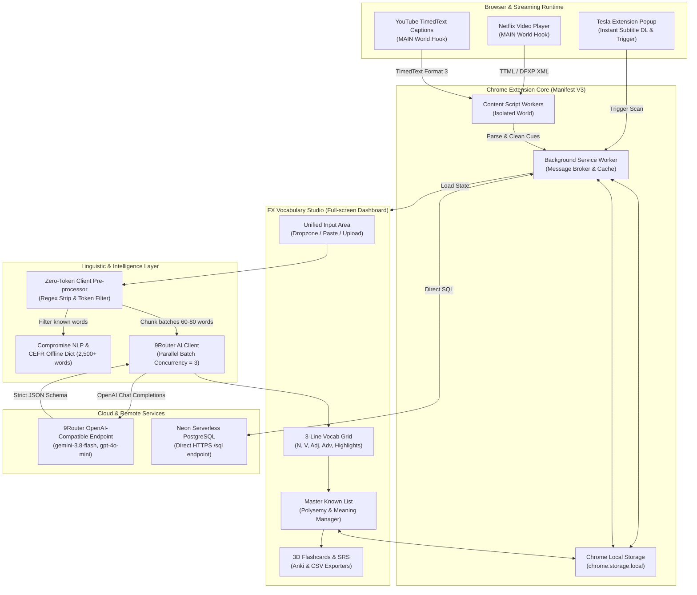
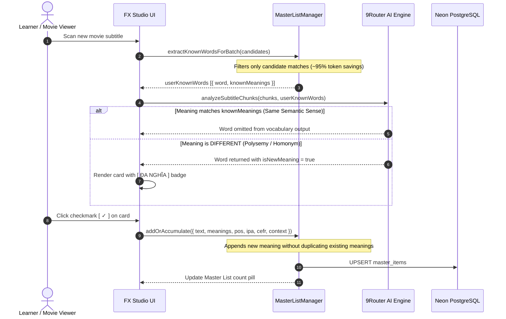

# FX English — Intelligent Subtitle Acquisition & AI Linguistic Studio

> **Enterprise-grade Chrome Extension (Manifest V3) & Linguistic Learning Studio** designed for acquiring English through real-world dialogue on **Netflix** and **YouTube**. Built with a utilitarian **Tesla Design System**, powered by an asynchronous **9Router AI linguistic engine** (OpenAI-compatible), an intelligent **Polysemy-aware Master Known List**, and direct **Neon Serverless PostgreSQL** persistence.

---

## 1. System Architecture & Component Topology

FX English operates as a distributed client-side architecture composed of a Manifest V3 Chrome Extension, headless content workers hooked into video streaming runtimes, an offline linguistic engine, an asynchronous AI batch pipeline, and serverless database synchronization.



---

## 2. Tesla UI/UX Design System

FX English is engineered around a utilitarian, hyper-focused aesthetic inspired by Tesla vehicle telemetry and minimalist control interfaces. Every element prioritizes information density, legibility, and distraction-free cognitive focus.

### 2.1 Core Visual Philosophy
- **Matte Carbon Palette**: Deep dark background (`#0A0A0B`), elevated matte card surfaces (`#141416`), and subtle contrast borders (`rgba(255, 255, 255, 0.06)`).
- **Zero System Emoji Rule**: System emojis (such as ⚡, 🌟, 📖, 🎴) are strictly prohibited across all user-facing surfaces, alerts, and status badges. All visual semantics are conveyed exclusively via clean text labels and 1.5px stroke monochrome vector SVGs from the Lucide design language.
- **Micro-Dot Status Indicators**: Dynamic states are indicated using minimal 6px circular dots:
  - Active / Connected: `#10B981` (Emerald Green)
  - Processing / Busy: `#F59E0B` (Amber Orange)
  - Error / Disconnected: `#E50914` (Crimson Red)
- **High-Contrast Monochrome Typography**: Inter and Plus Jakarta Sans typefaces with high contrast hierarchy (`#F4F4F6` for primary titles, `#71717A` for metadata and nuance explanations).
- **Tactile Micro-Interactions**: Crisp 120ms transitions with solid white CTA buttons (`#FFFFFF` background, `#000000` text) without ambient glow or color-cycling gradients.

### 2.2 Color Token Reference

| Token Name | Hex / RGBA Value | Applied Role |
| :--- | :--- | :--- |
| `--bg-main` | `#0A0A0B` | Root background of Popup and Studio |
| `--surface-card` | `#141416` | Vocabulary cards, history panels, modal sheets |
| `--surface-card-hover` | `#1C1C1F` | Hover state for interactive cards and list items |
| `--border-subtle` | `rgba(255, 255, 255, 0.06)` | Structural dividers, card borders, tab outlines |
| `--border-active` | `rgba(255, 255, 255, 0.20)` | Active tab borders, focused inputs, selected cards |
| `--text-primary` | `#F4F4F6` | Headings, lemma terms, bold primary text |
| `--text-muted` | `#71717A` | Metadata labels, IPA transcripts, context quotes |
| `--accent-white` | `#FFFFFF` | Primary action button background (text `#000000`) |
| `--dot-active` | `#10B981` | Neon DB online, Mastered indicator, success dot |
| `--dot-danger` | `#E50914` | Error states, disconnect warning, delete action |

### 2.3 The 3-Line Vocabulary Card Layout

Each vocabulary item in the Studio and Master List is rendered in an optimized, high-density 3-line format:

```
+-----------------------------------------------------------------------------------------------+
|  industry   [ ĐA NGHĨA ]   [ N · B2 ]                                              [ ☆ ]  [ ✓ ]|
|  /ˈɪndəstri/  (speaker)  ·  ngành công nghiệp [×]   giới kinh doanh [×]  [+]                  |
|  "All modern industries must adapt quickly to survival constraints."                          |
+-----------------------------------------------------------------------------------------------+
```

1. **Line 1 (Identity & Categorization)**: Base lemma in bold white (`18px`), optional `ĐA NGHĨA` badge (if polysemic), POS label and CEFR level indicator (`[ N · B2 ]`), followed by quick-action buttons: Bookmark star (`☆` / `★`) and Mastered checkmark (`✓`).
2. **Line 2 (Phonetics & Contextual Meaning)**: US IPA notation, one-click text-to-speech audio pronunciation, and one or more concise Vietnamese definitions. Each definition features an inline delete button (`×`), with a mini add button (`+`) to manually register additional meanings.
3. **Line 3 (Authentic Dialogue Quote)**: The exact line spoken in the film with the target word highlighted and underlined. Irrelevant timing tokens and raw seconds are completely suppressed for clean readability.

---

## 3. Asynchronous 9Router AI Linguistic Engine

Traditional in-browser language tools rely on static dictionary matching or fire hundreds of uncoordinated HTTP requests, triggering rate limits and leaving card states frozen on *"Đang tra nghĩa..."*. FX English replaces this with a client-side orchestrator communicating with an OpenAI-compatible endpoint.

### 3.1 Pipeline Mechanics

1. **Zero-Token Client Pre-processing**:
   - Subtitle cues (`.SRT`, `.VTT`, Netflix TTML, YouTube XML) are parsed into plain text.
   - HTML tags (`<i>`, `<b>`, `<span>`), sound effect captions (`[UPBEAT MUSIC]`, `[APPLAUSE]`), and timecodes are stripped using high-performance regular expressions.
   - Trivial stop words (pronouns, basic prepositions, interjections) are filtered out via an in-memory hash set.
2. **Parallel Batch Chunking**:
   - Filtered candidate words and their source dialogue sentences are assembled into chunks of 60 to 80 words.
   - A concurrent task pool executes up to 3 parallel requests simultaneously (`Promise.all` with concurrency throttler), keeping completion times under 3 seconds even for feature-length movies.
3. **Strict JSON Schema Output**:
   - Responses are validated against a strict schema containing `vocabulary` (lemmas, original forms, POS, CEFR, US IPA, contextual translation, frequency, and polysemy flag) and `highlights` (colloquial idioms, phrasal verbs, slang, and cultural nuances).

### 3.2 AI System Prompt Specification

```text
You are an elite linguistic engine and lexicographer specialized in movie/TV dialogue subtitle analysis for English learners.
Analyze the provided subtitle dialogue items, cross-reference with `userKnownWords` (if provided), and return ONLY a valid, raw JSON object matching the exact schema below.

CORE LINGUISTIC RULES:
1. LEMMATIZATION & CANONICAL FORMS:
   - Convert inflected tokens to lowercase base dictionary lemmas (e.g., 'ran' -> 'run', 'phenomena' -> 'phenomenon').
   - For phrasal verbs, extract the canonical infinitive (e.g., 'broke down' -> 'break down').
   - Deduplicate lemmas and sum frequencies.
2. ACCURATE POS & DISAMBIGUATION:
   - Classify based on the ACTUAL syntactic function in the specific movie context:
     * N (Noun): Exclude pronouns ('this', 'someone'), determiners, and character proper names.
     * V (Verb): Exclude auxiliary/modal verbs ('is', 'have', 'would', 'can').
     * Adj (Adjective): Correctly classify participle adjectives ('a broken heart' -> Adj 'broken').
     * Adv (Adverb): Correctly identify adverbs and adverbial particles ('there', 'suddenly', 'away').
3. NATURAL CONTEXTUAL VIETNAMESE MEANING:
   - Provide a natural, idiomatic Vietnamese translation (1-4 words, maximum 5 words) matching the exact nuance of the movie quote.
   - Avoid robotic word-by-word machine translations.
4. MASTER LIST & POLYSEMY RESOLUTION (CRITICAL):
   - Compare the contextual meaning of each candidate word with the `knownMeanings` in `userKnownWords`.
   - Semantic Equivalence: Treat meanings as THE SAME if they are synonyms, paraphrases, or closely related nuances. OMIT the word completely.
   - New Semantic Sense: ONLY treat as DIFFERENT if it represents a distinct semantic sense, lexical domain, or metaphor. INCLUDE with "isNewMeaning": true.
   - For words not in `userKnownWords`, include with "isNewMeaning": false.
5. HIGHLIGHTS (IDIOMS, PHRASAL VERBS, SLANG):
   - Extract natural colloquial idioms, phrasal verbs, slang, or conversational chunks from dialogue quotes.
   - Categorize each as: "phrasal_verb" | "idiom" | "slang" | "collocation".
```

### 3.3 Default Configuration & Custom Endpoints

Configuration is stored in `chrome.storage.local` with fallback to `localStorage`:

| Setting Key | Default Value | Notes |
| :--- | :--- | :--- |
| `baseUrl` | `http://localhost:20128/v1` | Automatically normalized with `/v1` suffix if omitted |
| `apiKey` | Pre-configured 9Router key | Can be updated via the in-app Settings modal |
| `model` | `ag/gemini-3.8-flash-low` | Compatible with `gemini-3.8-flash`, `gpt-4o-mini`, `claude-3-5-haiku` |

---

## 4. Master Known List & Semantic Deduplication Engine

The **Master Known List** solves the core dilemma of language learners: how to avoid relearning familiar words while ensuring that words encountered in entirely new meanings are never missed.

### 4.1 Data Model (`MasterItem`)

```typescript
export interface MasterItem {
  id: string;                  // Unique hash identifier (e.g. "word_break")
  text: string;                // Canonical lemma or phrase in lowercase (e.g. "take off")
  type: "word" | "sentence";   // Word entity vs. communicative phrase
  pos?: "N" | "V" | "Adj" | "Adv" | "Idiom";
  knownMeanings: string[];     // Array of Vietnamese meanings mastered by user
  ipa?: string;                // International Phonetic Alphabet notation
  cefr?: string;               // CEFR level (A1, A2, B1, B2, C1, C2)
  context?: string;            // Primary dialogue context sentence
  createdAt: string;           // ISO 8601 creation timestamp
}
```

### 4.2 Polysemy Accumulation Workflow



### 4.3 Client-Side Token Pre-filtering (~95% Token Savings)
Instead of serializing the entire user database into every prompt, `extractKnownWordsForBatch(candidates)` inspects only the words present in the current batch. If a movie batch contains 70 words, only the 10-15 words that intersect with the user's known database are sent in `userKnownWords`, saving up to 95% of prompt token overhead.

---

## 5. Neon Serverless PostgreSQL Persistence

FX English connects directly to **Neon Serverless PostgreSQL** using direct HTTPS queries against the `/sql` endpoint, enabling cloud synchronization without requiring a custom Node.js middleware server.

### 5.1 Relational Schema

```sql
-- 1. Scanned Movie and Video Metadata
CREATE TABLE IF NOT EXISTS movies (
    id VARCHAR(128) PRIMARY KEY,
    title VARCHAR(255) NOT NULL,
    platform VARCHAR(32) NOT NULL,
    video_id VARCHAR(64),
    duration_sec INT DEFAULT 0,
    subtitle_count INT DEFAULT 0,
    created_at TIMESTAMP WITH TIME ZONE DEFAULT CURRENT_TIMESTAMP,
    last_scanned_at TIMESTAMP WITH TIME ZONE DEFAULT CURRENT_TIMESTAMP
);

-- 2. Vocabulary Items Associated with Movies
CREATE TABLE IF NOT EXISTS vocabulary (
    id VARCHAR(128) PRIMARY KEY,
    movie_id VARCHAR(128) REFERENCES movies(id) ON DELETE CASCADE,
    word VARCHAR(128) NOT NULL,
    original_form VARCHAR(128),
    pos VARCHAR(32) NOT NULL,
    cefr VARCHAR(8) DEFAULT 'B1',
    frequency INT DEFAULT 1,
    ipa VARCHAR(64),
    vietnamese VARCHAR(255),
    context_sentence TEXT,
    context_start_sec FLOAT DEFAULT 0,
    created_at TIMESTAMP WITH TIME ZONE DEFAULT CURRENT_TIMESTAMP
);

-- 3. High-Value Communicative Expressions & Idioms
CREATE TABLE IF NOT EXISTS highlights (
    id VARCHAR(128) PRIMARY KEY,
    movie_id VARCHAR(128) REFERENCES movies(id) ON DELETE CASCADE,
    phrase VARCHAR(255) NOT NULL,
    category VARCHAR(32) NOT NULL,
    meaning_vi VARCHAR(255) NOT NULL,
    context_sentence TEXT NOT NULL,
    nuance TEXT,
    created_at TIMESTAMP WITH TIME ZONE DEFAULT CURRENT_TIMESTAMP
);

-- 4. Global Master Known List
CREATE TABLE IF NOT EXISTS master_items (
    id VARCHAR(128) PRIMARY KEY,
    text VARCHAR(128) NOT NULL UNIQUE,
    type VARCHAR(32) NOT NULL DEFAULT 'word',
    pos VARCHAR(16),
    known_meanings JSONB NOT NULL DEFAULT '[]'::jsonb,
    ipa VARCHAR(64),
    cefr VARCHAR(8),
    context TEXT,
    created_at TIMESTAMP WITH TIME ZONE DEFAULT CURRENT_TIMESTAMP,
    updated_at TIMESTAMP WITH TIME ZONE DEFAULT CURRENT_TIMESTAMP
);
```

### 5.2 Fault Tolerance & Offline Mode
All database operations in `lib/neonClient.js` run asynchronously in the background. If the network drops or Neon credentials are not configured, the application falls back immediately to local `chrome.storage.local` and `localStorage`, ensuring zero disruption to the user experience.

---

## 6. Directory Structure & Codebase Map

```
fx-english/
├── manifest.json              # Chrome Extension Manifest V3 configuration
├── package.json               # NPM scripts, test commands, and metadata
├── LICENSE                    # MIT Open Source License
├── README.md                  # Comprehensive architectural and user documentation
│
├── background/
│   └── background.js          # Service Worker coordinating message passing, storage, and API
│
├── content/
│   ├── netflixInjected.js     # MAIN world script hooking into Netflix videoPlayer API
│   ├── netflixContent.js      # Isolated content worker capturing Netflix TTML captions
│   ├── youtubeInjected.js     # MAIN world script intercepting YouTube caption player response
│   └── youtubeContent.js      # Isolated content worker fetching YouTube TimedText format 3
│
├── popup/
│   ├── popup.html             # Minimalist Tesla-style popup interface
│   ├── popup.css              # Styling tokens for popup (monochrome, high-density)
│   └── popup.js               # Media detection and instant format download triggers
│
├── studio/
│   ├── studio.html            # Full-screen workspace (History, Input, Grid, Master List, Modal)
│   ├── studio.css             # Complete Tesla design system and 3D card flip styles
│   ├── studio.js              # View orchestration, search, filter tabs, modal controls
│   └── src/
│       ├── state.js           # Reactive UI state management
│       ├── controllers/
│       │   └── flashcardController.js  # 3D Flashcard flip animation and SRS progression
│       └── services/
│           ├── audioService.js         # Browser SpeechSynthesis TTS integration
│           └── exportService.js        # Anki Deck (.txt) and CSV format generators
│
├── lib/
│   ├── types.js               # Domain constants: POS codes, CEFR tiers, SRS ratings
│   ├── subtitleParser.js      # Universal parser (SRT, WebVTT, YouTube XML, Netflix TTML)
│   ├── compromise.js          # In-browser NLP parser for local syntactic tagging
│   ├── cefrDict.js            # Offline dictionary of 2,500+ words with CEFR levels and IPA
│   ├── vocabAnalyzer.js       # Local lemma frequency analyzer and context extractor
│   ├── aiClient.js            # 9Router OpenAI-compatible batch linguistic client
│   ├── masterList.js          # Master Known List & polysemy accumulation engine
│   └── neonClient.js          # Direct HTTPS client for Neon Serverless PostgreSQL
│
├── icons/                     # Extension branding icons (16px, 32px, 48px, 128px, 512px)
└── test/
    └── verify.js              # Comprehensive test runner (16 unit and integration test suites)
```

---

## 7. Project Conventions & Coding Standards

To ensure long-term maintainability and reliability across browser runtimes, all contributions must adhere to the following architectural standards:

### 7.1 The Zero-Emoji Policy
System emojis are never used in production code, HTML templates, CSS pseudo-elements, console alerts, or documentation headings. Statuses, indicators, and labels must be expressed through:
- Semantic text labels (e.g., `ĐA NGHĨA`, `DANH TỪ`, `B1`)
- Standard monochrome vector SVGs (1.5px stroke from Lucide)
- Minimal colored dot indicators (`#10B981` / `#E50914`)

### 7.2 Universal Module Compatibility (UMD Pattern)
Core logic modules residing in `lib/` (`types.js`, `subtitleParser.js`, `cefrDict.js`, `vocabAnalyzer.js`, `aiClient.js`, `masterList.js`, `neonClient.js`) must remain environment-agnostic. They must be executable within:
1. Chrome Extension Background Service Workers (V3 `self` context)
2. In-browser DOM environments (`window` context)
3. Node.js unit and integration test runners (`module.exports` context)

```javascript
(function (root, factory) {
  if (typeof module === 'object' && module.exports) {
    module.exports = factory();
  } else {
    root.APP_MODULE_NAME = factory();
  }
})(typeof self !== 'undefined' ? self : this, function () {
  'use strict';
  // Core module logic
});
```

### 7.3 Manifest V3 Messaging Protocols
- All communication between Content Scripts, Popup, Studio, and Background Service Worker is conducted via typed `chrome.runtime.sendMessage` and `chrome.runtime.onMessage` handlers.
- Messages must specify an explicit `type` constant (e.g., `PARSE_SUBTITLES`, `RUN_AI_ANALYSIS`, `GET_MASTER_LIST`).
- Content scripts operating in the `MAIN` execution world must transfer extracted subtitle streams to the `ISOLATED` world via `window.postMessage`, which in turn relays the data to the Service Worker.

---

## 8. Installation & Setup Guide

### 8.1 Installing the Chrome Extension

1. Clone or download the repository to your local workstation:
   ```bash
   git clone https://github.com/17130239-coder/fx-english.git
   ```
2. Open Google Chrome and navigate to:
   ```text
   chrome://extensions/
   ```
3. Enable **Developer mode** using the toggle in the upper right corner.
4. Click **Load unpacked** in the top left and select the `fx-english` folder.
5. The **FX English** icon will appear on your Chrome extension toolbar.

### 8.2 Configuring 9Router AI

1. Open the **FX Vocabulary Studio** by clicking the extension icon and selecting **Tách từ vựng**, or right-click the icon and choose **Options**.
2. Click the **AI** settings button in the top navigation bar.
3. Verify or enter your connection parameters:
   - **Base URL**: `http://localhost:20128/v1` (or `https://api.9router.com/v1`)
   - **API Key**: Enter your 9Router key (e.g., `sk-9866...`)
   - **Model ID**: Select or type your target model (e.g., `ag/gemini-3.8-flash-low` or `gemini-3.8-flash`)
4. Click **Kiểm tra & Lưu**. The interface will perform a test handshake and save your configuration.

---

## 9. Verification & Automated Test Suite

FX English includes an automated test runner (`test/verify.js`) covering 16 unit and integration test suites with zero external dependencies.

### 9.1 Running Verification Commands

```bash
# 1. Run strict syntax check across all JavaScript files
npm run check-syntax

# 2. Run the full 16-suite unit and integration test runner
npm test
```

### 9.2 Test Coverage Summary

```text
Running FX English Test Suite...

1. Verifying manifest.json and icon assets...
   - Manifest V3 and 5 icon assets verified.
2. Loading core NLP & Domain modules...
   - All 4 core libraries loaded successfully.
3. Testing Universal Subtitle Parser (SRT, VTT, TXT)...
   - Subtitle parser passed: SRT, VTT, clean TXT conversions verified.
4. Testing Offline CEFR Dictionary & Morphology...
   - CEFR dictionary passed: IPA, Vietnamese definitions & morphology verified.
5. Testing POS Categorizer (Danh, Động, Tính, Trạng)...
   - POS Categorization passed with high accuracy.
6. Testing Anki & CSV Exporters...
   - Anki and CSV export formatting verified.
7. Testing YouTube Format 3 TimedText Parser...
   - YouTube format 3 XML parser passed.
8. Testing Netflix TTML / DFXP XML Subtitle Parser...
   - Netflix TTML/DFXP parser passed with tickRate conversion.
9. Testing Neon Database Schema & Migration Verification...
   - Neon PostgreSQL schema tables verified.
10. Testing Neon Direct Query & Persistence...
    - Neon Direct Query passed.
11. Testing Cross-Device Movie Sync Query...
    - Cross-Device Movie Sync passed.
12. Testing Starred Words & Flashcard State Persistence...
    - Starred state persistence verified.
13. Testing POS Context Disambiguation (Homographs)...
    - Homograph disambiguation verified (race, watch, plan).
14. Testing Word Mastery & Bookmark State Persistence...
    - Word mastery and bookmark states verified.
15. Testing 9Router AI Linguistic Engine Client...
    - Lemmatization, deduplication, contextual translations, and highlights verified.
16. Testing Master Known List & Semantic Deduplication Engine...
    - Meaning accumulation, polysemy filtering, token pre-filtering, and Anki/CSV exports verified.

====================================================
ALL UNIT & INTEGRATION TESTS PASSED (100% OK)
====================================================
```

---

## 10. Interoperability & Export Specifications

### 10.1 Anki Deck Export Format
Exports are generated as tab-separated `.txt` files compatible with Anki Desktop and AnkiMobile:

- **Header**: `#separator:tab\n#html:true\n#tags:FX-English Netflix Movie-Vocabulary\n`
- **Field 1 (Front)**: Target word or idiom in bold white styling, accompanied by phonetic IPA and POS indicator.
- **Field 2 (Back)**: Natural contextual Vietnamese translation, list of known accumulated meanings, and the authentic dialogue quote with the target word highlighted.

### 10.2 CSV Spreadsheet Export
Exports conform to RFC 4180 standards for direct import into Microsoft Excel, Apple Numbers, and Google Sheets, with headers:
`Text, Type, POS, KnownMeanings, CreatedAt`.

---

## 11. Security & Privacy Model

- **No Remote Telemetry**: FX English does not track browsing history, user credentials, or streaming behaviors.
- **Client-Side Processing**: Subtitle parsing, linguistic tokenization, and stop-word filtering occur entirely within the user's browser runtime.
- **Direct Peer Communication**: AI inference requests communicate directly from the user's browser to the configured 9Router endpoint without traversing intermediate tracking servers.
- **Encrypted Database Communication**: Remote database synchronization with Neon uses SSL-encrypted (`sslmode=require`) HTTPS POST requests.

---

## 12. License

Distributed under the [MIT License](LICENSE).  
Authored by **Nguyen Van Thuong** (`17130239-coder`).
